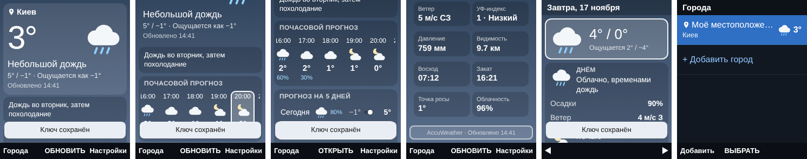

# Погода для KaiOS

Лёгкое приложение погоды для кнопочных телефонов на KaiOS 2.5 и 3.x
(Nokia 8110 4G, 2720 Flip, 800 Tough, 6300 4G, Jio Phone и др.).
Данные — AccuWeather. Интерфейс в духе погоды из MIUI / Pixel, переделанный под экран 240×320 и кнопки.



## Что умеет

- Текущая погода: температура, состояние, макс./мин., «ощущается как». Фон меняется от погоды и времени суток.
- Почасовой прогноз на 12 часов (листается ◀ ▶) с вероятностью осадков.
- Прогноз на 5 дней со шкалой температур, как в Pixel; по нажатию — подробности дня и ночи.
- Плитки «Сейчас»: ветер, УФ-индекс, давление, видимость, влажность, восход/закат, точка росы, облачность.
- Несколько городов + «Моё местоположение» (GPS / сеть). Переключение городов — ◀ ▶.
- Русский, украинский, английский; °C / °F. Для ru/uk ветер в м/с, давление в мм рт. ст.
- Офлайн: показывает последние сохранённые данные с пометкой «нет связи».

## Управление

| Кнопка | Действие |
|---|---|
| ▲ ▼ | прокрутка по блокам |
| ◀ ▶ | переключить город; в почасовом блоке — листать часы; на экране дня — соседний день |
| Центральная | обновить; на строке дня — открыть подробности |
| Левая софт-клавиша | список городов (там же «Добавить» / «Удалить») |
| Правая софт-клавиша | настройки |
| Назад | вернуться наверх / на предыдущий экран / выйти |

## API-ключ AccuWeather (нужно сделать вручную)

Ключ нельзя получить автоматически — нужна регистрация:

1. Зарегистрируйтесь на <https://developer.accuweather.com>.
2. Создайте приложение (My Apps → Add a new App) и выберите бесплатный тариф Core Weather.
3. Скопируйте API Key.

Важно: сейчас у AccuWeather бесплатный тариф — это **пробный период** с лимитом запросов в сутки, а не вечный бесплатный доступ.
Условия могут меняться, проверяйте их на сайте. Приложение экономит лимит: одно обновление одного города — 3 запроса,
данные кэшируются (по умолчанию на 1 час, можно поставить до 3 ч), переключение городов идёт из кэша,
а повторное определение города по GPS делается, только если вы сместились больше чем на 5 км.

Как передать ключ в приложение — любой из способов:

- **На телефоне:** Настройки → «API-ключ AccuWeather» → ввести → «Сохранить».
- **При сборке:** `ACCUWEATHER_KEY=ваш_ключ ./build.sh` — ключ попадёт только в архив в `dist/`, не в git.

Не записывайте ключ в `js/config.js` и не коммитьте его: репозиторий публикуется через GitHub Pages.

## Сборка и установка

```sh
cd kaios-weather
ACCUWEATHER_KEY=ваш_ключ ./build.sh    # или просто ./build.sh
```

В `dist/` появятся:

- `app/` — папка приложения: для **WebIDE** (KaiOS 2.5: Firefox 59 / Waterfox Classic → WebIDE → Open Packaged App)
  или для `appscmd` на KaiOS 3;
- `application.zip` — архив приложения;
- `weather-omnisd.zip` — пакет для установки через **OmniSD** / Wallace Toolbox (нужен режим разработчика).

Тип приложения — `privileged`: это нужно для разрешения `systemXHR` (сервер AccuWeather не отдаёт CORS-заголовки,
поэтому обычные веб-запросы с телефона не работают) и для геолокации.
`manifest.webapp` — для KaiOS 2.5, `manifest.webmanifest` — для KaiOS 3.x.

## Устройство

```
index.html            разметка (экран + панель софт-клавиш)
css/app.css           стили под 240×320, без CSS grid / blur / тяжёлых теней
js/config.js          ключ из сборки, версия
js/i18n.js            тексты ru / uk / en
js/icons.js           векторные иконки погоды (inline SVG, коды AccuWeather 1–44)
js/api.js             запросы к AccuWeather, ужатие ответа для кэша
js/app.js             экраны, навигация с клавиш, кэш, геолокация
```

JavaScript написан на ES5 (без стрелочных функций, `let`, `async`), чтобы работать на старом движке Gecko 48 в KaiOS 2.5.
Весь пакет — около 40 КБ.
